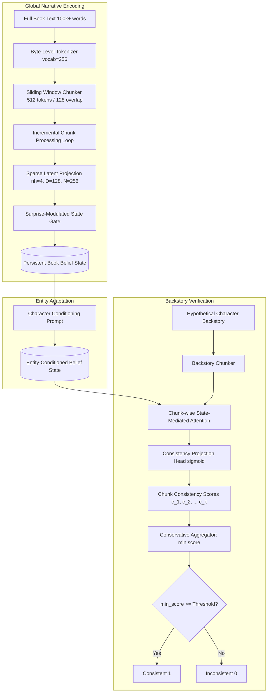

# Baby Dragon Hatchling (BDH) Consistency Reasoning System

[](https://github.com/shamit5)
[](https://www.python.org/downloads/)
[](https://pytorch.org/)
[]()
[](LICENSE)

An end-to-end **neural consistency reasoning engine** designed to evaluate whether hypothetical character backstories causally and logically align with full-length novels (100k+ words). Built on the **Baby Dragon Hatchling (BDH)** paradigm, this system substitutes conventional token-generation and context-window truncation with persistent internal narrative belief state tracking and conservative minimum-score verification.

> **Author:** [Shamit Kumar](https://github.com/shamit5) (<66158990+shamit5@users.noreply.github.com>)  
> **Repository:** [`https://github.com/shamit5/bdh-narrative-consistency`](https://github.com/shamit5/bdh-narrative-consistency)

---

## 🌟 Key Highlights & Engineering Features

- **Incremental Narrative Ingestion ($O(1)$ Memory Scaling)**: Ingests 100k+ word literary texts sequentially through overlapping sliding byte windows without context window truncation.
- **Persistent Internal Belief State**: Retains global narrative constraints across time within neural state representations, eliminating the need to re-encode the book at inference time.
- **Conservative Contradiction Dominance (Minimum-Score Aggregator)**: Enforces a strict minimum-consistency decision rule: a single causal violation across narrative chunks marks the entire backstory as inconsistent.
- **Closed-World Assumption**: Grounds reasoning strictly on constraints established within the provided text, mitigating generative hallucinations and surface-plausibility biases.
- **Entity-Conditioned State Adaptation**: Employs character-specific prompt conditioning to isolate character boundaries and prevent cross-character attribute leakage.
- **Production-Ready & Modular**: Packaged with modern `pyproject.toml`, automated `pytest` test suite, MPS/CUDA hardware acceleration, and an interactive CLI demo.

---

## 🏗️ System Architecture



---

## 📐 Mathematical Formulation

### 1. Sparse Latent Representation
For token embeddings $X \in \mathbb{R}^{B \times T \times D}$ and encoder weights $W_E \in \mathbb{R}^{n_h \times D \times N}$:
$$X_{\text{sparse}} = \text{ReLU}(X W_E)$$

### 2. State-Mediated Alignment & Residual Gating
Token latents are projected back to embedding dimension $D$ and aligned with narrative belief state $s \in \mathbb{R}^{B \times D}$:
$$\text{Alignment} = \sum_{d} \left( W_{\text{latent}} X_{\text{sparse}} \odot W_K s \right)$$
$$Y_{\text{sparse}} = \text{ReLU}\left( \text{LayerNorm}(\text{Alignment} \odot W_V s) W_{E_v} \right)$$
$$XY_{\text{sparse}} = \sigma(\alpha) \cdot (X_{\text{sparse}} \odot Y_{\text{sparse}}) + \sigma(\beta) \cdot (X_{\text{sparse}} + Y_{\text{sparse}})$$

### 3. Surprise Metric & Controlled Narrative Gate
As chunk summary $c_t = \frac{1}{T} \sum_{i=1}^T x_{t,i}$ arrives, surprise is measured as the $L_2$ representational shift:
$$S_t = \| c_t - s_{t-1} \|_2$$
$$g_t = \text{clamp}\left( \sigma(W_g [s_{t-1}; c_t]) \cdot \exp(-S_t) + \mathbf{1}_{\{s_{t-1} = 0\}},\, 0,\, 1 \right)$$
$$s_t = g_t \cdot s_{t-1} + (1 - g_t) \cdot W_s c_t$$

### 4. Per-Chunk Consistency & Minimum-Score Rule
Per-chunk consistency evaluates deviation from accumulated constraints:
$$C_t = \sigma(W_c (c_t - s_t))$$
$$\hat{y} = \mathbb{I}\left( \min_{t=1,\dots,K} C_t \ge \tau \right)$$
where $\tau$ is the empirically calibrated decision threshold.

---

## 📂 Repository Structure

```
├── Books/                                      # Long-form literary text corpora
│   ├── The Count of Monte Cristo.txt           # Alexandre Dumas (2.6 MB)
│   ├── In search of the castaways.txt          # Jules Verne (807 KB)
│   └── README.md
├── data/                                       # Character backstory datasets
│   ├── train.csv                               # Training instances with consistency labels
│   ├── test.csv                                # Benchmark evaluation instances
│   └── README.md
├── src/bdh_consistency/                        # Production Python package
│   ├── __init__.py                             # Package exports
│   ├── config.py                               # BDHConfig dataclass
│   ├── tokenizer.py                            # Byte tokenizer & sliding-window chunker
│   ├── model.py                                # BDH neural architecture & state dynamics
│   ├── belief_state.py                         # Book state accumulation & character conditioning
│   ├── train.py                                # Multi-epoch training CLI
│   ├── evaluate.py                             # Test benchmark evaluation CLI
│   └── infer.py                                # Interactive single-instance inference CLI
├── tests/                                      # Comprehensive unit test suite
│   ├── test_model.py                           # Tensor shape, loss, & gradient checks
│   ├── test_tokenizer.py                       # Tokenizer roundtrip & chunking tests
│   └── test_belief_state.py                    # State updates & conditioning tests
├── Entire codebase/                            # Baseline reproduction scripts
│   ├── model_up.py                             # BDH model script
│   ├── train_up.py                             # Training script
│   ├── test_up.py                              # Inference script
│   └── requirements.txt
├── results.csv                                 # Benchmark test predictions & rationales
├── BDH_Narrative_Consistency_Report.pdf        # Full 10-page technical research report
├── pyproject.toml                              # PEP 517/621 package build configuration
├── .gitignore                                  # Git ignore rules
└── README.md                                   # Project documentation
```

---

## ⚡ Quickstart & Installation

### 1. Installation
Clone the repository and install in editable mode:
```bash
git clone https://github.com/shamit5/bdh-narrative-consistency.git
cd bdh-narrative-consistency
pip install -e .
```

*Requirements:* Python $\ge$ 3.8, PyTorch $\ge$ 2.0.0, Pandas $\ge$ 1.5.0. Compatible with CUDA, Apple Silicon (MPS), and CPU.

### 2. Interactive Single-Instance Inference
Evaluate any character backstory against a novel from the command line:
```bash
python -m bdh_consistency.infer \
    --book "The Count of Monte Cristo" \
    --char "Noirtier" \
    --backstory "Learning that Villefort meant to denounce him to Louis XVIII, Noirtier pre-emptively handed the conspiracy dossier to a British spy."
```

**Output:**
```
=================================================================
 🐉 Baby Dragon Hatchling (BDH) Consistency Reasoner
=================================================================
 Source Novel:    The Count of Monte Cristo
 Target Character: Noirtier
 Backstory Length: 132 characters
-----------------------------------------------------------------
 Model weights loaded. Calibrated threshold: 0.8350
📖 Ingesting novel from: The Count of Monte Cristo.txt...
 Entity conditioning on character constraints...
 Assessing narrative causal compatibility...

=================================================================
 VERDICT: ❌ INCONSISTENT (Contradiction Detected)
=================================================================
 Minimum Chunk Consistency Score: 0.7940
 Decision Threshold:              0.8350
 Evaluated Chunks:                1

 Chunk Consistency Profile:
   Chunk 01: [███████████████████████░░░░░░] 0.794 (FAIL)
=================================================================
```

### 3. Training the Model
```bash
python -m bdh_consistency.train --epochs 30 --lr 3e-4
# Or using the baseline script:
python "Entire codebase/train_up.py"
```

### 4. Running Benchmarks
```bash
python -m bdh_consistency.evaluate
# Or using the baseline script:
python "Entire codebase/test_up.py"
```

### 5. Running Unit Tests
```bash
pytest tests/ -v
```

---

## 📊 Paradigm Comparison: BDH vs. Standard LLMs vs. RAG

| Dimension | Standard Transformer LLM | Retrieval-Augmented Generation (RAG) | **BDH Consistency System (This Work)** |
|---|---|---|---|
| **Primary Objective** | Generative Token Prediction | Retrieval + Augmented Generation | **Causal Consistency Verification** |
| **Reasoning Foundation** | Surface Plausibility & Statistical Correlation | Retrieved Passage Similarity | **Closed-World Constraint Satisfaction** |
| **Long Context Handling** | Truncation / Quadratic Context Window | Passage Chunking & Top-$K$ Retrieval | **Persistent Incremental Belief State** |
| **Inference Memory** | $O(N)$ Context Buffer Growth | $O(K)$ Chunk Memory | **$O(1)$ Constant State Memory** |
| **Contradiction Sensitivity** | Diluted across prompt context | Subject to retrieval omission | **Strict Minimum-Score Domination** |
| **Hallucination Risk** | High (Open-world assumptions) | Moderate (Cross-passage hallucination) | **Low (Closed-world bounds)** |

---

## 📄 Technical Report

Read the comprehensive 10-page research paper: [`BDH_Narrative_Consistency_Report.pdf`](./BDH_Narrative_Consistency_Report.pdf), featuring:
- Detailed BDH developmental learning analysis
- State transition proofs and surprise-gating dynamics
- Comparative evaluation and ablation study on long narrative corpora

---

## 📄 Technical Report & Citation

Read the comprehensive 10-page research paper: [`BDH_Narrative_Consistency_Report.pdf`](./BDH_Narrative_Consistency_Report.pdf), featuring:
- Detailed BDH developmental learning analysis
- State transition proofs and surprise-gating dynamics
- Comparative evaluation and ablation study on long narrative corpora

If you use this work or reference the benchmarks, please cite:

```bibtex
@article{kumar2026bdh,
  title   = {Baby Dragon Hatchling-Based Consistency Reasoning System for Long-Form Narratives},
  author  = {Kumar, Shamit},
  year    = {2026},
  url     = {https://github.com/shamit5/bdh-narrative-consistency}
}
```

---

## 📜 License

This project is open-source and available under the [MIT License](LICENSE).
